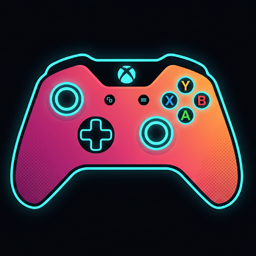

<p align="center">
  
</p>

<h1 align="center">re-B.U.N.S</h1>
<p align="center">
  <strong>Native Windows &amp; macOS Keyboard &amp; Mouse → Xbox &amp; PlayStation Controller Remapper for GTA 6</strong>
</p>

<p align="center">
  <a href="https://github.com/FaZeBuns/re-B.U.N.S/releases/tag/v1.6.6-windows">
    
  </a>
  &nbsp;&nbsp;
  <a href="https://github.com/FaZeBuns/re-B.U.N.S/releases/tag/v1.6.4-mac">
    
  </a>
</p>

<p align="center">
  <a href="https://github.com/FaZeBuns/re-B.U.N.S/releases/tag/v1.6.6-windows">
    
  </a>
  &nbsp;
  <a href="https://github.com/FaZeBuns/re-B.U.N.S/releases/tag/v1.6.4-mac">
    
  </a>
  &nbsp;
  
</p>

---

**re-B.U.N.S** is a high-performance, native (C# / .NET 8, zero Electron bloat) keyboard and mouse to virtual Xbox 360 & DualShock 4 PlayStation controller remapper designed specifically for **GTA 6**. Available natively for both **Windows 10/11** and **macOS** (Apple Silicon M-series & Intel).

---

## 🚀 Downloads & Quick Start

### 🪟 Windows Setup (3 Steps)
1. Download **[`re-BUNS.exe`](https://github.com/FaZeBuns/re-B.U.N.S/releases/tag/v1.6.6-windows)** (via the Windows button above).
2. Double-click **`re-BUNS.exe`** (single standalone file — if ViGEmBus driver is needed, it installs automatically with 1 click).
3. Choose your GTA 6 Control Scheme preset, switch layout between **Xbox** and **PlayStation** anytime, and click **`▶ START VIRTUAL PAD`**.

### 🍏 macOS Setup (3 Steps)
1. Download **[`re-B.U.N.S-macOS.zip`](https://github.com/FaZeBuns/re-B.U.N.S/releases/tag/v1.6.4-mac)** (via the macOS button above).
2. Extract the zip and drag **`re-B.U.N.S.app`** into your **`/Applications`** folder.
3. Open **System Settings → Privacy & Security → Accessibility** and enable **`re-B.U.N.S`**.
4. Click **`▶ START VIRTUAL PAD`**, then launch your game or click **`🌐 Launch Cloud`**!

---

## 🎮 Virtual Controller Web Emulator & Tester

re-B.U.N.S features a built-in graphical **Web Gamepad Emulator & Tester**:
- Accessible at **`http://127.0.0.1:27654/`** while re-B.U.N.S is running.
- Visual Xbox 360 & DualShock 4 controller schematic with responsive analog sticks, triggers (0–255), and glowing button indicators.
- Live W3C Gamepad API telemetry validating instant compatibility with **Xbox Cloud Gaming (`play.xbox.com`)**, **GeForce NOW**, **PlayStation Remote Play**, and browser-based emulators.
- Interactive in-browser keyboard & mouse test sandbox to practice bindings before jumping into the game.

---

## ✨ Features

- **Dual Xbox 360 & PlayStation (DualShock 4) Support**:
  - Switch seamlessly between **Xbox** and **PlayStation** controller layouts with 1 click.
  - Windows: Creates a native **Xbox 360** or **Sony DualShock 4** virtual device via ViGEmBus.
  - UI dynamically updates all GTA 6 schematic prompts and glyphs (`A/B/X/Y/LB/RB` ↔ `✕/○/□/△/L1/R1/L2/R2`).
- **Cross-Platform Native Parity**:
  - **Windows**: Low-level kernel driver integration via ViGEmBus for 100% native XInput gamepad emulation in all Windows games and apps.
  - **macOS**: High-speed low-level `CGEventTap` input hooks with zero-latency local W3C Gamepad HTTP bridge (`http://127.0.0.1:27654/pad`) and automatic browser extension injection.
- **GTA 6 Control Scheme UI & 4 Built-In Presets**:
  1. **`1 / 4  ·  ★ re-B.U.N.S`** — Custom GTA 6 keyboard & mouse preset (`WASD` Move, `Mouse` Look, `L-Shift` Run, `Space` Jump, `Q/Tab` Holster/Loadout/Cover, `E` Action/Cover, `R` Reload/Melee, `F/Wheel` Vehicle/Interact, `L-Ctrl/C` Crouch/Look Behind, `Arrows + B/N/Z/T` D-Pad).
  2. **`2 / 4  ·  Default`** — Matches GTA 6's in-game `1/3 Default` control scheme.
  3. **`3 / 4  ·  Classic`** — Matches GTA 6's in-game `2/3 Classic` control scheme.
  4. **`4 / 4  ·  Left-Handed`** — Matches GTA 6's in-game `3/3 Left-Handed` control scheme.
- **Tap vs. Hold (`◎`) & Double-Tap Support**:
  - Supports **1:1 Tap & Hold**, **Single Tap**, **Long Hold (`◎` 650ms auto-hold)**, and **Double-Tap** activators for multi-function GTA 6 controller buttons (Cellphone / Waink App, Holster / Loadout, Radio Controls / Radio Menu, Crouch / Rest, etc.).
- **1000 Hz Zero-Allocation Input Engine**:
  - Configurable X/Y Sensitivity, Anti-Deadzone %, Response Curve, Smoothing (ms), and Y-Axis Invert.
- **Automatic GitHub Updates**:
  - Automatically checks GitHub Releases on launch and offers a 1-click update popup when a new version is published.

---

## ⌨️ Global Hotkeys

| Platform | Hotkey | Action |
| :--- | :--- | :--- |
| **Windows** | **`Windows Key`** | **Pause / Play Virtual Pad** (unlocks cursor to switch windows; does NOT open Start menu or unfocus `play.xbox.com`) |
| **macOS** | **`⌘ Command`** | **Pause / Play Virtual Pad** (unlocks cursor to manage macOS apps/tabs) |
| **Windows** | **`Ctrl + Alt + Delete`** | **Emergency Stop** (disconnects the virtual controller immediately) |
| **macOS** | **`Control + Option + Delete`** | **Emergency Stop** (disconnects the virtual controller immediately) |

---

## 🛠️ Building from Source

Requires the [.NET 8.0 SDK](https://dotnet.microsoft.com/download/dotnet/8.0):

### Windows
```powershell
dotnet build re-B.U.N.S/re-B.U.N.S.csproj -c Release
```

### macOS
```bash
dotnet build re-B.U.N.S.Mac/re-B.U.N.S.Mac.csproj -c Release
```

### Run Self-Test
```bash
dotnet run --project re-B.U.N.S.Mac/re-B.U.N.S.Mac.csproj -- --self-test
```

---

## 📄 License

Licensed under the [MIT License](LICENSE).
